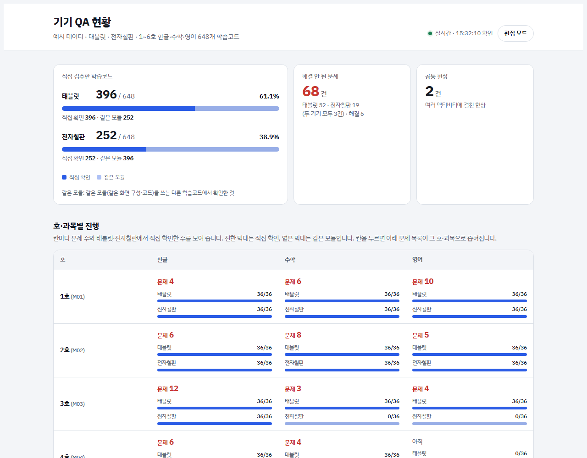
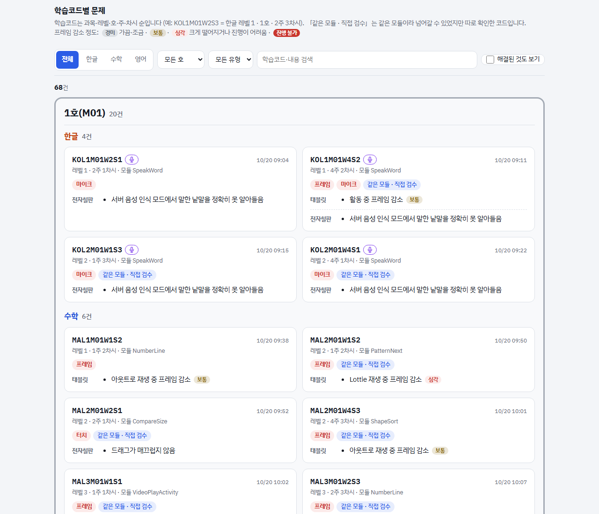
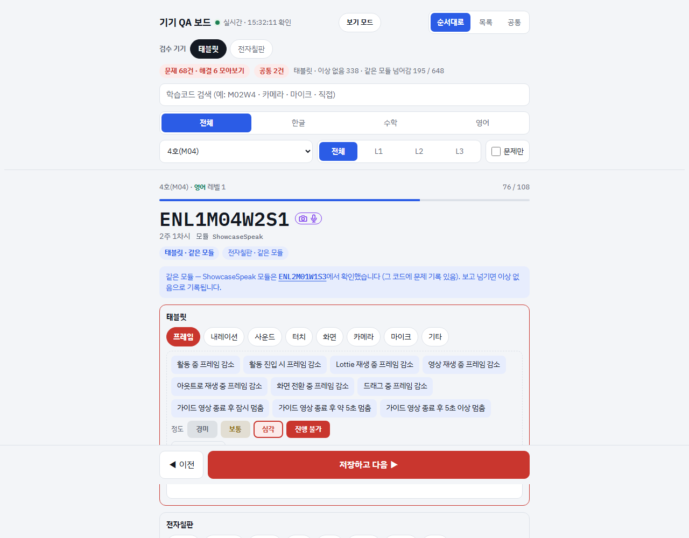
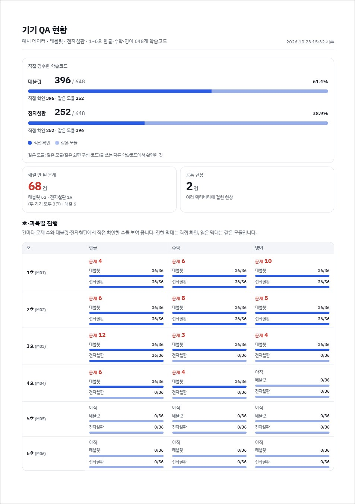

# Device QA Board — 학습 콘텐츠 실기기 검수 기록 · 현황 보고

> 학습 액티비티 648개를 **태블릿과 전자칠판 두 기기에서 직접 돌려 보며** 문제를 적고,
> 그 기록을 **진행 현황 화면과 A4 PDF 보고서**로 바로 보여 주는 웹 도구입니다.
> 혼자 만들고 실제 검수에 썼습니다. Cloudflare Worker + D1 무료 범위에서 돌아갑니다.

**English summary** — A small web app for on-device QA of 648 learning activities across two devices (tablet and
interactive whiteboard). Testers walk through activity codes one by one, tag issues per device with one-tap phrase chips,
and skip codes that share an already-verified module. The same page flips into a read-only status report for managers
(progress per month × subject, open issues grouped by month and subject) that prints to a clean A4 PDF for email.
Single HTML page + Cloudflare Worker + D1, polling a revision counter so several testers see each other's edits.

> **공개본 안내** — 회사에서 쓰는 사이트에서 검수 기록, 학습코드 → 모듈 매핑, 기기 제품명, 운영 주소를 덜어 낸 사본입니다.
> 화면에 보이는 **모든 기록은 `build/seed.js` 가 만든 예시 데이터**이고, 모듈 이름과 카메라 · 마이크 표시도 같은 모양으로 지어낸 것입니다.

---

## 왜 만들었나

학습 콘텐츠는 학습코드(액티비티) 단위로 나옵니다. 영업용 앱에 들어간 6개 호 × 3과목 × 3레벨 × 4주 × 3차시 = **648개**를
교실에 들어갈 **태블릿과 전자칠판 두 기기에서** 직접 돌려 봐야 했습니다.

- 기기마다 결과가 다릅니다. 같은 코드가 태블릿에서는 프레임이 떨어지고 전자칠판에서는 마이크 인식이 문제였습니다.
  기록이 기기별로 나뉘어야 했습니다.
- 648개를 다 보는 것은 무리였습니다. 액티비티는 **모듈(게임 틀) 코드를 공유**하므로, 같은 모듈을 쓰는 코드를 한 기기에서
  확인했다면 그 기기에서는 넘어가도 됩니다. 어디까지 직접 봤고 어디가 같은 모듈로 덮였는지 구분해 보여야 했습니다.
- 윗분들은 학습코드 목록보다 「얼마나 봤고, 무엇이 문제인가」를 봅니다. 같은 기록으로 **현황 화면**과 **메일에 붙일 PDF**가
  나와야 했습니다.

## 무엇을 하나

| 화면 | 기능 |
|---|---|
| **편집 · 순서대로** | 학습코드를 하나씩 띄우고 아래 큰 단추로 「이상 없음 · 다음」. 손가락이 닿는 아래쪽에 단추를 두어 태블릿을 든 채로 넘김. 같은 모듈을 이미 확인했으면 어느 코드에서 봤는지 알려 줌 |
| **편집 · 유형 칩 → 문구 칩** | 프레임 · 내레이션 · 사운드 · 터치 · 화면 · 카메라 · 마이크 · 기타. 칩을 누르면 자주 쓰는 문구가 떠서 눌러 넣음. 프레임은 상황 문구 + **정도 칩(경미 · 보통 · 심각 · 진행 불가)** |
| **편집 · 검수 기기** | 지금 기록이 어느 기기로 쌓이는지 늘 보임. 이상 없음 · 순서대로 위치도 기기별로 따로 |
| **편집 · 목록 / 공통** | 모든 코드를 호 · 과목 · 레벨로 묶어 보기. 여러 액티비티에 걸친 현상은 「공통」에 따로 |
| **보기 모드** | 기기별 직접 검수 비율, 해결 안 된 문제, 호 × 과목 표(칸마다 문제 수와 기기별 진행 막대), 문제 유형 분포, 호 → 과목으로 묶은 학습코드별 문제 |
| **PDF** | 보기 모드를 A4 로 인쇄. 밝은 색 고정, 필터 · 단추 빼고, 표는 첫 장에, 문제 목록은 새 장에서 |
| **함께 쓰기** | 로그인 없이 링크로. 8초마다 바뀐 게 있는지만 확인하고, 바뀌었을 때만 전체를 받음 |

카메라 · 마이크를 쓰는 학습코드에는 코드 옆에 아이콘이 붙고, 그 코드에서만 카메라 · 마이크 칩이 보입니다.

## 화면

### 보기 모드 — 진행 현황



### 보기 모드 — 학습코드별 문제 (호 → 과목, 프레임 정도 칩)



### 편집 모드 — 순서대로, 프레임 상황 문구와 정도 칩



### PDF 첫 장 (메일 보고용)



## 설계에서 신경 쓴 것

**기록 원문은 그대로, 화면에서만 정리** — 검수가 진행되며 「프레임 약간 감소」 「크게 감소」 「감소 (활동 진행 어려움)」처럼
표현이 늘었습니다. 기록을 일괄로 고치는 대신 화면에서만 읽어 `상황 + 프레임 감소 + 정도 칩`으로 보여 줍니다
(`frameLevel` — 간혹 · 약간 → 경미, 꾸밈말 없음 → 보통, 크게 · 진행 어려움 → 심각, 진행 불가). 편집 화면의 정도 칩은
마지막 프레임 줄 끝에 `(심각)`처럼 붙이고, 같은 해석기가 그것도 읽습니다.

**같은 모듈은 기기별로, 직접 본 것과 구분** — 코드 → 모듈 색인으로 「이 기기에서 같은 모듈을 쓰는 다른 코드를 확인했는가」를
셉니다. 진행 막대는 진하게 직접 확인, 옅게 같은 모듈 두 칸만 둡니다(나눠 보이면 헷갈린다는 의견을 받아 줄임).
같은 모듈이라 넘어갈 수 있었는데 따로 확인한 코드에는 「같은 모듈 · 직접 검수」 태그가 붙습니다.

**동시에 여러 사람이 써도 기록이 안 사라지게** — 입력칸을 연 시점의 저장 내용을 기준으로 사람이 실제로 고친 경우에만
「바뀜」으로 봅니다. 예전에는 다른 기기의 저장이 늦게 도착하면 빈 입력칸이 「지운 것」으로 판단되어 기록이 삭제됐습니다.
덮어쓰거나 지우기 전의 기록은 `history` 묶음에 남깁니다.

**싸고 단순한 동기화** — 문서 하나가 D1 의 한 줄이고, 쓸 때마다 `meta.rev` 를 올립니다. 페이지는 `/api/ver` 숫자만
8초마다 보고(화면이 보일 때만), 바뀌었을 때만 `/api/all` 을 받습니다. 무료 한도 안에서 여러 명이 같이 씁니다.

**보고서는 인쇄 CSS 로** — 별도 보고서 생성기 없이 보기 모드 그대로 `@media print` 로 A4 를 맞췄습니다.
헤드리스 Chrome 의 `Page.printToPDF` 로 뽑고(`tools/pdf.js`), 인쇄 시각을 머리에 찍어 언제 자료인지 보이게 했습니다.

## 폴더

```
page/qa-board.html   편집 화면 (HTML · CSS · JS 한 파일)
build/report.*       보기 모드 화면 (HTML 조각 · CSS · JS)
build/tail.js        저장소(Cloudflare D1)와 보기 ↔ 편집 전환
build/make.js        위 조각을 합쳐 public/index.html 을 만듦
build/seed.js        예시 기록 → seed.sql
src/worker.js        API — GET /api/ver · /api/all, PUT · DELETE /api/doc/<묶음>/<id>
schema.sql           표 두 개 (docs, meta)
tools/pdf.js         보기 모드 → A4 PDF (헤드리스 Chrome)
```

## 실행

```bash
npm install
npm run seed      # 예시 기록을 로컬 D1 에 넣음
npm run dev       # http://127.0.0.1:8787
```

PDF 는 서버를 띄운 채로:

```bash
node tools/pdf.js http://127.0.0.1:8787/ report.pdf
```

배포는 `npx wrangler d1 create device-qa-board` 로 만든 id 를 `wrangler.toml` 에 넣고,
`npx wrangler d1 execute device-qa-board --remote --file schema.sql` 다음 `npm run deploy`.

> 로그인이 없어 **링크를 아는 사람은 누구나 고칠 수 있습니다.** 팀 안에서 링크로 나눠 쓰려고 그렇게 했습니다.
> 바깥에 열어 둘 거라면 Cloudflare Access 같은 것을 앞에 두세요.
